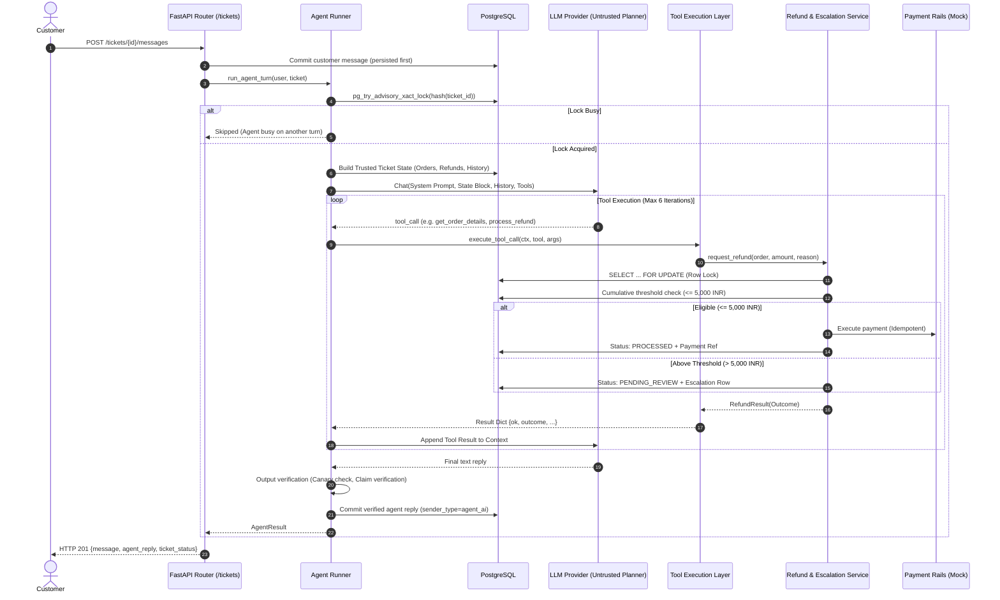

# AI Customer Support Agent Architecture

## Core Principle: LLM as an Untrusted Planner

In this platform, the Large Language Model (LLM) is treated strictly as an **untrusted planner and dialogue orchestrator**. 

- The LLM **cannot directly execute database writes**, mutate order statuses, or initiate fund transfers.
- The LLM can only interact with the backend by requesting tool invocations.
- Tools are thin wrappers around authoritative backend services (`request_refund`, `access.py`, `escalations.py`).
- The backend services—incorporating row-level locks, cryptographic idempotency keys, strict policy boundaries, and PostgreSQL database constraints—remain the **sole and final authority**.

---

## Defense in Depth: Layer-by-Layer Architecture

| Defense Layer | Mechanism & Enforcement | Threat Mitigated |
|---|---|---|
| **1. Prompt & State Layer** | Trusted DB ticket-state block injected every turn; strict instruction framing ("Data vs Instructions"); Canary token embedding (`CANARY_SEC_TOKEN_XYZ_847291`). | Prompt injection, goal hijacking, instruction revelation attacks, hallucinated order details. |
| **2. Tool Interface & Gating** | Model sees only 4 customer-safe tools; parameter whitelist with `additionalProperties: False`; `LOOK_UP_ORDER_FIRST` precondition gate; Read-only mode withholding financial tools on escalated/resolved tickets. | Direct injection of unauthorized parameters (e.g. spoofed `customer_id`, `role=admin`), unauthorized writes on escalated tickets. |
| **3. Authorization & Tenant Boundary** | `get_order_for_user` and `get_ticket_for_user` enforce customer ownership; 404 NOT_FOUND returned on unowned records with identical messages. | Horizontal privilege escalation, tenant enumeration, IDOR. |
| **4. Service Policy Invariants** | Cumulative order refund threshold (`existing_refunds + amount <= 5000.00`); 30-day return window from delivery date; grocery non-returnable check; strict Decimal validation with $\le 2$ decimal places. | Refund splitting attacks, policy evasion, fractional cent rounding exploits, expired return fraud. |
| **5. Database Concurrency & Constraints** | Advisory transaction locks (`pg_try_advisory_xact_lock`) per ticket; `SELECT ... FOR UPDATE` row locks on orders; partial unique indexes on active refunds; unique idempotency keys. | Race conditions, concurrent double-refunds, duplicate payout execution. |
| **6. Output Claim Verification** | Regex claim detector audits assistant replies; rewrites ungrounded claims of refund processing if not backed by a verified `PROCESSED` tool outcome in the trace; canary token scrub. | Agent hallucinating false approval to customer, prompt leakage. |

---

## Known Limitations & Production Roadmap

1. **Keyword-Based Policy Retrieval**:
   - *Current Implementation*: Category retrieval uses heading-split keyword and term frequency (TF) token overlap without vector embeddings.
   - *Production Path*: Replace with pgvector or semantic vector search for multi-lingual and nuanced natural language queries.

2. **In-Database Advisory Locks**:
   - *Current Implementation*: Uses PostgreSQL `pg_try_advisory_xact_lock` keyed on ticket UUID.
   - *Production Path*: For multi-region or distributed deployments with external queues (e.g. Celery / Redis / Kafka), consider a distributed lock (e.g. Redlock) or actor-based turn queue.

3. **Synchronous Turn Execution (No Streaming)**:
   - *Current Implementation*: Runs synchronous tool iterations in the HTTP request cycle up to a 45-second wall-clock budget.
   - *Production Path*: Transition to Server-Sent Events (SSE) or WebSockets with chunk streaming for reduced perceived latency.

4. **Regex-Based Claim Verification**:
   - *Current Implementation*: Uses compiled regex heuristics to detect refund commitments and prompt leakage.
   - *Production Path*: Complement regex checks with a secondary lightweight classification model or deterministic state-machine output template.
