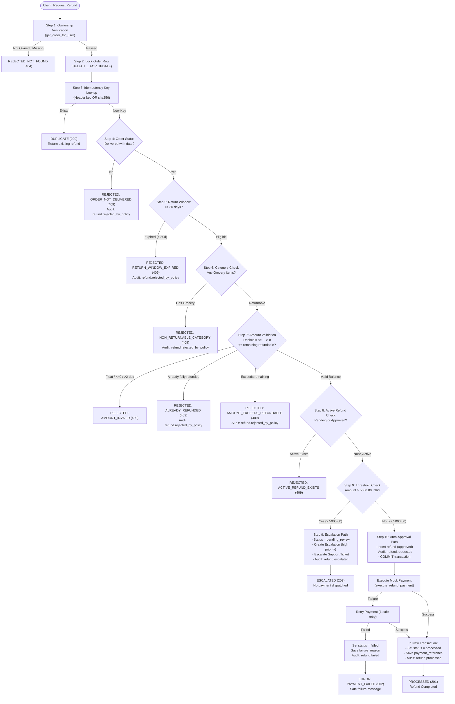

# Refund Processing Architecture & Policy Flow

This document details the end-to-end refund workflow, security invariants, concurrency controls, and error mapping for the e-commerce customer support platform.

---

## 1. End-to-End Workflow Diagram

The refund execution pipeline follows a strict, sequential 11-step evaluation inside a transactional row lock.

---

## 2. Core Security & Concurrency Invariants

1. **Single Execution Path**:
   All refunds—whether initiated by a customer, triggered by an AI agent, or reviewed and approved by human staff—execute through the exact same backend engine in `app/services/refunds.py`. No endpoint or background task may bypass policy checks, insert unvalidated refund rows, or directly invoke payment rails.

2. **Row-Level Serialization (`SELECT ... FOR UPDATE`)**:
   Every refund evaluation begins by acquiring an exclusive row lock on the target `Order`. This serializes all concurrent requests for the same order, guaranteeing that balance calculations (`order.total_amount - SUM(active_refunds)`) remain atomic and immune to race-condition double-spending.

3. **Idempotency Key Enforcement**:
   Every refund request is identified either by a client-supplied `Idempotency-Key` HTTP header or an automatic cryptographic fingerprint `sha256(f"{user.id}:{order.id}:{amount}")`. Duplicate submissions return the existing refund object with HTTP 200 without creating new records or triggering duplicate payment charges.

4. **Partial Unique Index as Database Backstop**:
   PostgreSQL enforces `uq_refunds_one_active_per_order` on `order_id` where `status IN ('pending_review', 'approved', 'processed')`. If an unexpected race slips past in-memory checks, the database constraint reliably halts conflicting transactions via `IntegrityError`, mapped cleanly to `DUPLICATE` or `ACTIVE_REFUND_EXISTS` without ever returning a 500 internal server error.

5. **Backend Is the Final Authority**:
   No client-supplied status, reviewed_by, or payment data is trusted or accepted. Strict Pydantic models with `extra="forbid"` reject any unauthorized payload fields. Monetary values are strictly validated as `Decimal` with at most 2 decimal places. Floating-point numbers are rejected immediately.

---

## 3. Reason Code to HTTP Status Code Mapping

| Outcome | Reason Code | HTTP Status | Description / Client Message |
| :--- | :--- | :---: | :--- |
| `PROCESSED` | `None` | **201 Created** | Refund approved and payment processed successfully. |
| `ESCALATED` | `None` | **202 Accepted** | Refund amount exceeds automatic threshold; routed to human staff for review. |
| `DUPLICATE` | `None` | **200 OK** | A refund with this idempotency key was already created; returns existing record. |
| `REJECTED` | `NOT_FOUND` | **404 Not Found** | Order not found or not owned by the requesting customer. |
| `REJECTED` | `ORDER_NOT_DELIVERED` | **409 Conflict** | Refunds can only be requested for orders in delivered status. |
| `REJECTED` | `RETURN_WINDOW_EXPIRED` | **409 Conflict** | The 30-day return window from delivery date has expired. |
| `REJECTED` | `NON_RETURNABLE_CATEGORY` | **409 Conflict** | Order contains non-returnable merchandise (e.g., grocery items). |
| `REJECTED` | `AMOUNT_INVALID` | **409 Conflict** | Amount is negative, zero, has >2 decimals, or is a float. |
| `REJECTED` | `AMOUNT_EXCEEDS_REFUNDABLE` | **409 Conflict** | Amount requested exceeds remaining refundable balance on the order. |
| `REJECTED` | `ALREADY_REFUNDED` | **409 Conflict** | Order has already been fully refunded. |
| `REJECTED` | `ACTIVE_REFUND_EXISTS` | **409 Conflict** | An active refund request is already in progress for this order. |
| `ERROR` | `PAYMENT_FAILED` | **502 Bad Gateway** | Payment gateway declined or timed out; refund was NOT completed. |
| `ERROR` | `INTERNAL_ERROR` | **500 Internal Error** | Unexpected unhandled failure. |
