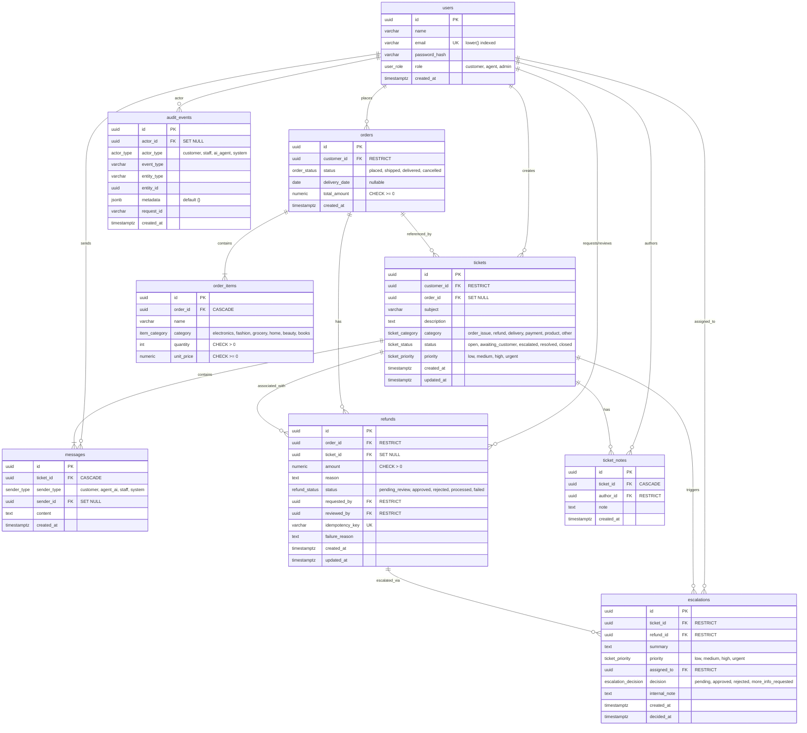

# Database Schema Documentation

This document describes the database architecture, table relationships, and key business invariants for Part 2 of the E-Commerce AI Customer Support platform.

---

## Entity-Relationship Diagram



---

## Key Invariants

1. **One Active Refund Per Order**:
   - Enforced by PostgreSQL partial unique index:
     ```sql
     CREATE UNIQUE INDEX uq_refunds_one_active_per_order
     ON refunds (order_id)
     WHERE status IN ('pending_review', 'approved', 'processed');
     ```
   - Terminal statuses (`rejected`, `failed`) free the slot, permitting a customer to file a subsequent eligible claim.

2. **Strict Financial Type Safety (No Float)**:
   - All monetary fields (`orders.total_amount`, `order_items.unit_price`, `refunds.amount`) use `Numeric(12, 2)`.
   - Single currency (INR) without fractional sub-paisa float rounding hazards.
   - Enforced by positive check constraints (`total_amount >= 0`, `unit_price >= 0`, `amount > 0`).

3. **Refund Idempotency**:
   - Every refund record requires a unique, non-null `idempotency_key` (`uq_refunds_idempotency_key`).
   - Prevents duplicate payouts from network retries, concurrent agent actions, or double submissions.

4. **Deliberate Referential Integrity (ON DELETE RESTRICT)**:
   - Financial ledger records (`orders`, `refunds`, `users`) cannot be deleted if referenced (`ON DELETE RESTRICT`).
   - `ON DELETE CASCADE` is permitted strictly on parent-dependent sub-entities (`order_items` on order delete, `messages` and `ticket_notes` on ticket delete).

5. **Append-Only Audit Log**:
   - `audit_events` is an immutable, append-only log capturing user, staff, system, and AI agent actions. Records are never updated or deleted.
